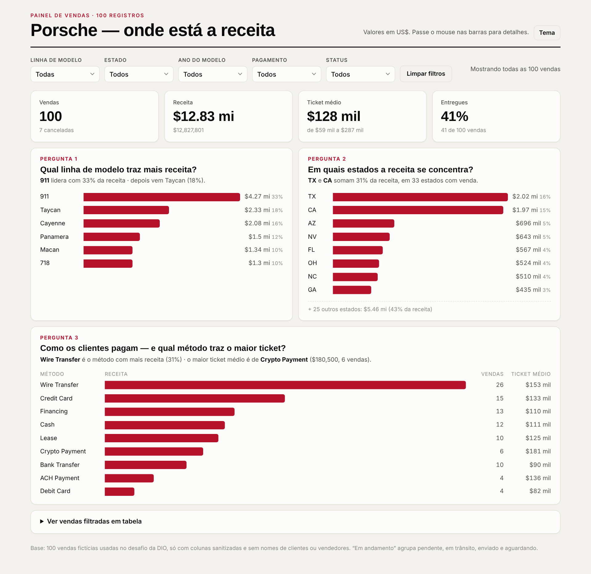
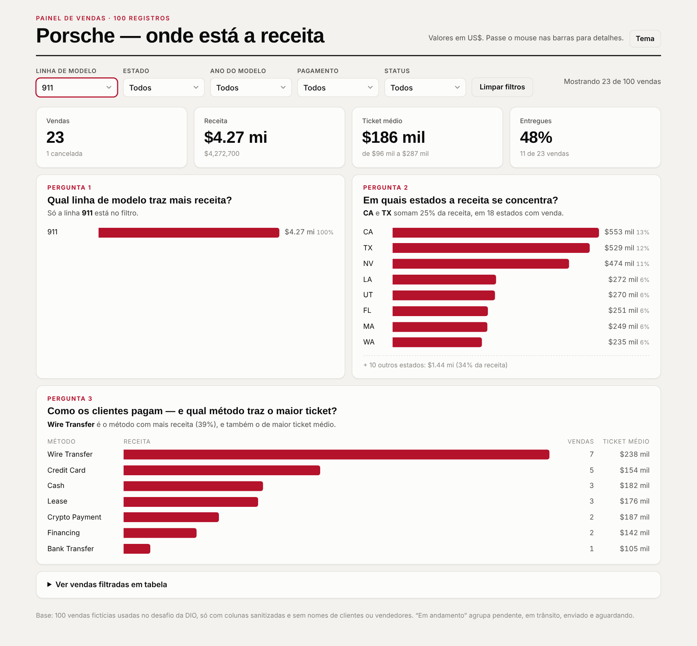

# dashboard-vendas-porsche

Dashboard em **HTML (arquivo único)** sobre 100 vendas de Porsche. Responde três perguntas de negócio, com filtros e indicadores de topo, e está publicada no GitHub Pages.

🔗 **Dashboard publicada:** https://SEU-USUARIO.github.io/dashboard-vendas-porsche/



## Perguntas de negócio

| # | Pergunta | Por que escolhi | Resposta na base completa |
|---|---|---|---|
| 1 | **Qual linha de modelo traz mais receita?** | Diz em qual produto concentrar estoque e marketing. Os 40 modelos foram agrupados em 6 linhas (911, Taycan, Cayenne, Panamera, Macan, 718) para o gráfico ser legível. | 911 lidera com 33% (US$ 4,27 mi), depois Taycan (18%) |
| 2 | **Em quais estados a receita se concentra?** | Mostra onde estão os mercados principais e se a receita depende de poucas praças. | TX e CA somam 31%, mas os 25 estados fora do top 8 ainda trazem 43%: a receita é espalhada |
| 3 | **Como os clientes pagam, e qual método traz o maior ticket?** | Receita e ticket médio contam histórias diferentes, e o volume de um método não diz o valor por venda. | Wire Transfer traz mais receita (31%); Crypto Payment tem o maior ticket (US$ 180,5 mil, mas só 6 vendas) |

**Indicadores de topo:** número de vendas (e canceladas), receita, ticket médio (com mínimo e máximo) e % de vendas entregues.

**Filtros:** linha de modelo, estado, ano do modelo, método de pagamento e status. Todos atualizam indicadores, gráficos, frases de resposta e a tabela de detalhes.

### Exemplo de filtro aplicado: linha 911

Com o filtro, o ticket médio sobe de US$ 128 mil para US$ 186 mil, e Wire Transfer passa a ser também o método de maior ticket.



## Tratamento da base

A planilha original do desafio (não incluída no repositório porque traz nomes de clientes e vendedores) tinha, para cada campo, a coluna crua e a coluna sanitizada (`...Sanitized`). O tratamento, em [`dados/tratamento.py`](dados/tratamento.py):

1. **Só colunas sanitizadas:** id, data, modelo, ano, preço, milhagem, pagamento, cidade, estado e status.
2. **Dados sensíveis removidos:** `customer_name` e `salesperson` não entram na base, porque ela fica embutida no HTML público.
3. **Tipos convertidos:** preço em número decimal (ex.: `"$121k"` → `121000.0`), ano e milhagem em inteiros.
4. **Colunas derivadas:**
   - `linha`: primeira palavra do modelo (`911 Turbo S` → `911`).
   - `status`: 10 status agrupados em 3 (Entregue, Cancelada, Em andamento).
5. **Datas `INVALID`:** 24 vendas têm datas impossíveis na origem (ex.: `2024-02-30`, `April 31st`). Elas ficaram vazias, e por isso a dashboard **não** usa a data de venda como filtro, só o ano do modelo. Além disso, 20 datas válidas estão no futuro (até 2027), mais um sinal de que a base é fictícia.

Resultado: [`dados/base_tratada.csv`](dados/base_tratada.csv) e `.xlsx`, com 100 linhas e 12 colunas, só valores, sem fórmulas.

## Ferramenta e prompt

A dashboard foi gerada com o **Claude** (assistente de IA da Anthropic), no lugar do ChatGPT com Canvas sugerido pelo desafio. *(Se você também fizer a versão no ChatGPT ou com um agente, compare as duas aqui.)*

Prompt base:

```
Crie uma dashboard em HTML, arquivo único, com os dados embutidos (base tratada em anexo,
100 vendas de Porsche, sem nomes de clientes).

Perguntas de negócio, cada uma com um gráfico de barras horizontais e uma frase de resposta
que se atualiza com os filtros:
1. Qual linha de modelo (911, Taycan, Cayenne, Panamera, Macan, 718) traz mais receita?
2. Em quais estados a receita se concentra? (top 8 estados)
3. Como os clientes pagam e qual método traz o maior ticket médio? (receita, nº de vendas e ticket)

Indicadores de topo: vendas, receita, ticket médio, % entregues.
Filtros em uma linha acima: linha de modelo, estado, ano do modelo, pagamento, status, e botão limpar.
Visual: inspirado em marca de carro esportivo — fundo off-white, texto quase preto,
um único vermelho de destaque, tipografia Archivo nos títulos e Inter no texto.
Tooltip ao passar o mouse, tabela das vendas filtradas, modo escuro e layout responsivo para celular.
```

### O que mudou até a versão final

- **Barra "Outros" no gráfico de estados:** na primeira versão, os 25 estados menores viravam uma barra de 43% que achatava as outras. Troquei por uma linha de texto abaixo do gráfico ("+ 25 outros estados: US$ 5,46 mi"), e as barras ficaram comparáveis.
- **Filtro sem resultado:** as frases de resposta mostravam o texto anterior quando nenhuma venda passava no filtro. Agora ficam vazias e aparece "Nenhuma venda com esses filtros".
- **Filtro de um item só:** "911 lidera com 100% da receita" virou "Só a linha 911 está no filtro".
- **Botão de tema:** o ícone ◐ aparecia cortado em algumas fontes, então virou o texto "Tema".

## Estrutura do repositório

```
index.html                  dashboard (dados embutidos)
images/dashboard.png        print da dashboard completa
images/filtro-911.png       print com filtro aplicado
dados/base_tratada.csv      base usada na dashboard
dados/base_tratada.xlsx
dados/tratamento.py         script de tratamento (pandas)
```

## Como publicar (GitHub Pages)

1. Crie o repositório público `dashboard-vendas-porsche` e suba os arquivos.
2. Vá em **Settings → Pages → Build and deployment**: Source = *Deploy from a branch*, Branch = `main` / `(root)`, depois **Save**.
3. Em 1 ou 2 minutos, a dashboard fica em `https://SEU-USUARIO.github.io/dashboard-vendas-porsche/`.
